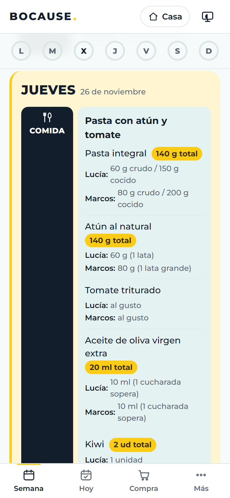
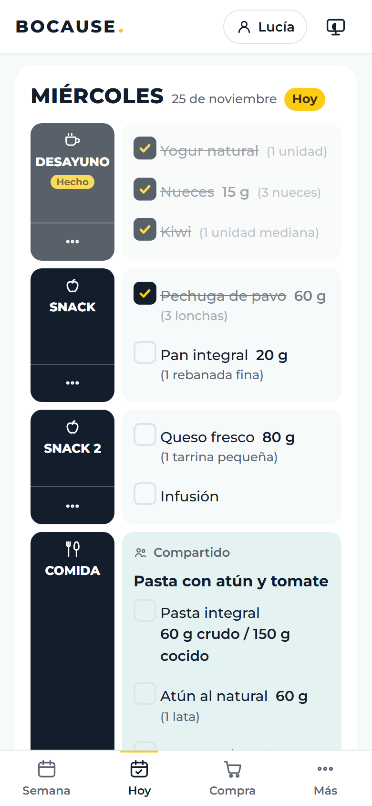
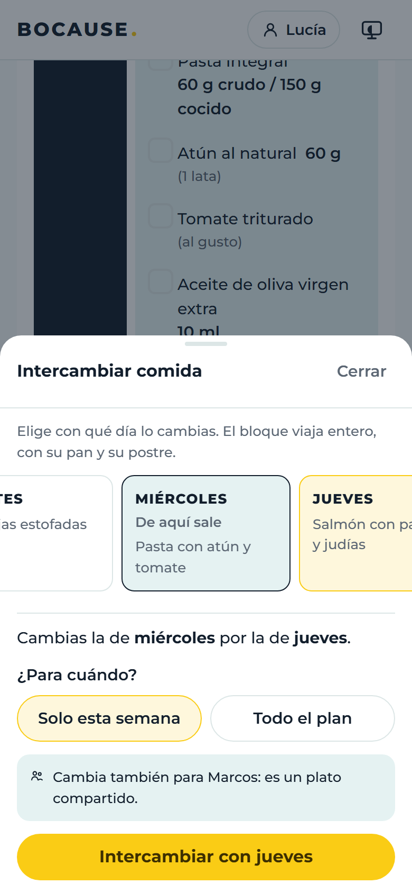
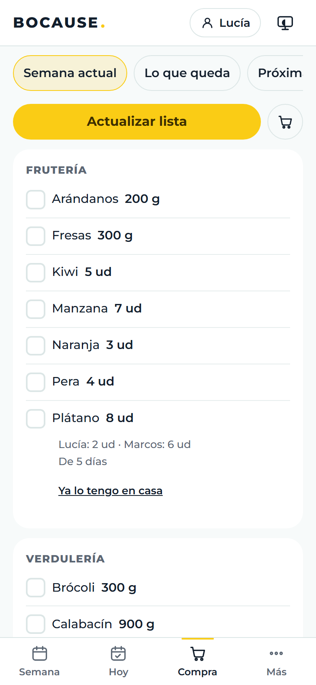
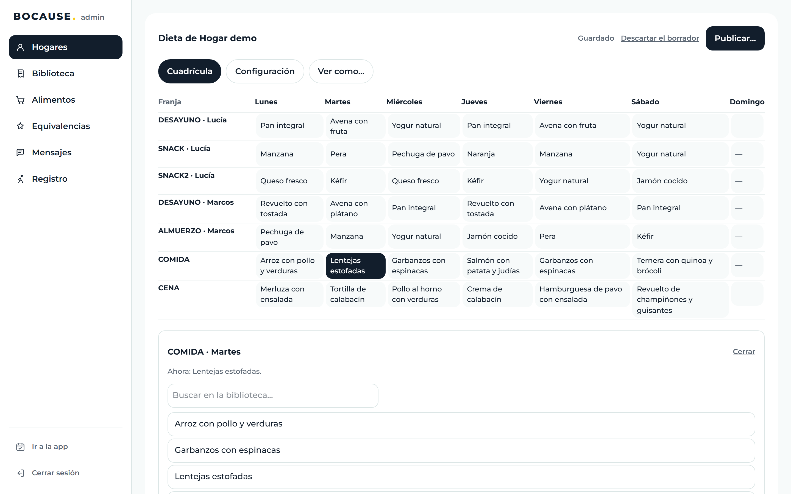
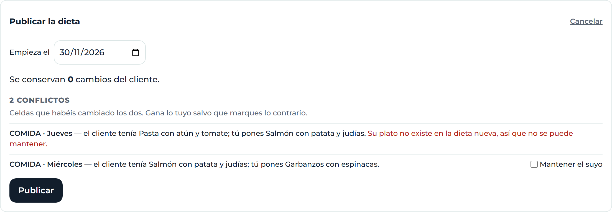
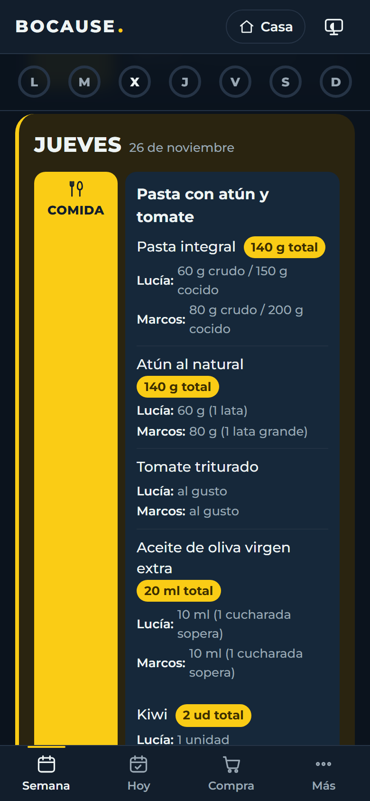

# Bocause Dieta

PWA para seguir la dieta que pauta una nutricionista, pensada para usarse con una mano, en la
cocina o en el súper, y a veces sin cobertura. Tiene dos caras: la app del cliente y un panel
donde la nutricionista crea y publica las dietas de cada hogar.

Desde octubre de 2026 la usa a diario un hogar real. El repositorio solo contiene datos
ficticios: el plan de ejemplo está en [`data/plans/demo.json`](data/plans/demo.json).

## Capturas

<table>
  <tr>
    <td align="center"><br><sub>Semana, vista Casa</sub></td>
    <td align="center"><br><sub>Hoy, con checks</sub></td>
    <td align="center"><br><sub>Intercambio entre días</sub></td>
    <td align="center"><br><sub>Lista de la compra</sub></td>
  </tr>
</table>

**Panel de la nutricionista:** la cuadrícula del constructor de dietas y, al publicar, los
conflictos con los cambios que había hecho el cliente.





<sub>Tema oscuro:</sub><br>


## Qué hace

**Para el cliente**

- **Semana y Hoy:** qué come cada persona en cada comida, con sus raciones. La unidad es el
  _hogar_: comida y cena se comparten, con una ración distinta para cada persona, y desayunos
  y snacks son individuales.
- **Check por alimento:** una comida queda hecha cuando están marcados todos sus alimentos.
  También lleva la cuenta del agua, el aceite semanal y las ingestas libres.
- **Intercambio de comidas entre días**, para esta semana o para todo el plan, con deshacer.
  Va en un carrusel de scroll-snap en vez de arrastrar y soltar, porque con una mano funciona
  mejor.
- **Edición sin perder el original:** cambiar un plato crea una copia que apunta al de la
  nutricionista, y "Restaurar original" siempre funciona.
- **Sustituciones** dentro de los grupos de equivalencia que define la nutricionista, con la
  cantidad ya convertida para cada persona.
- **Lista de la compra** que suma lo que come todo el hogar, ordenada por secciones del súper.
- **Chat privado** con la nutricionista, que se puede anclar a una comida concreta.
- **Historial de cambios** en frases legibles: «Cliente B intercambió la comida del lunes y
  del martes».

**Para la nutricionista** (`/admin`)

- Hogares, personas y cuentas: es ella quien da de alta a cada cliente, y nadie elige quién es.
- **Constructor de dietas** sobre un borrador que el cliente no ve, con vista previa "Ver
  como…".
- **Publicación con arrastre de cambios:** al publicar una dieta nueva, los ajustes que había
  hecho el cliente se conservan, y cada conflicto se enseña celda a celda antes de confirmar.
- Catálogo de alimentos, biblioteca de platos con escalado por persona y grupos de
  equivalencia.
- Seguimiento de la adherencia de cada persona, en modo de solo lectura.

## Stack

React 19 · TypeScript (`strict`, `noUncheckedIndexedAccess`) · Vite · Tailwind CSS v4 ·
TanStack Query persistido en IndexedDB · Zustand (solo estado de interfaz) · Zod · Supabase
(Postgres, Auth y Realtime) · vite-plugin-pwa con service worker propio · Vitest · Playwright ·
pgTAP.

No usa librerías de componentes. Tampoco carga recursos de terceros (CDN, Google Fonts ni
analítica): son datos de salud, y la tipografía va autoalojada.

## Decisiones técnicas

**Offline-first de verdad.** La caché de TanStack Query se persiste en IndexedDB, separada por
usuario, y las mutaciones son optimistas y **se reanudan** al volver la red. Una consulta que
falla no se trata como "sin datos": el arranque distingue cargando, pausada sin red, error y
respuesta. Confundir esos estados mandaba a alguien sin cobertura a la pantalla de "no tienes
dieta".

**Lógica de dominio pura.** `src/domain/` no importa nada del proyecto, ni React ni Supabase.
Ahí vive todo lo que tiene reglas: resolver la semana (cambio de esta semana → plantilla del
plan → vacío), intercambiar, copiar al escribir, escalar raciones, sumar la compra y decidir qué
cambios sobreviven a una publicación. Tiene una cobertura del 98 %.

**La seguridad está en la base de datos.** Todas las tablas tienen RLS, y las pruebas de
permisos (pgTAP) se escriben **antes** que la migración y se ven fallar. Algunos ejemplos:

- El autor de un mensaje del chat lo firma un trigger con `auth.uid()`. Si lo mandara el
  navegador, cualquiera podría escribir como si fuera la nutricionista.
- Las escrituras de la nutricionista sobre perfiles van por funciones `security definer` que
  comprueban `is_staff()` por dentro.
- El registro de cambios lo escriben triggers, así que también queda lo que llega tarde, cuando
  se reanuda una mutación hecha sin cobertura.
- Ninguna función se puede ejecutar sin sesión, tampoco las que se creen en el futuro
  ([`0011`](supabase/migrations/0011_funciones_sin_anon.sql)).
- Quien se registra por libre, sin un perfil asignado por la nutricionista, no ve ni siquiera
  el catálogo de la consulta ([`0012`](supabase/migrations/0012_biblioteca_solo_con_perfil.sql)).

**Preparada para varios hogares.** RLS es la última defensa, no el filtro: toda consulta
filtra por hogar de forma explícita, las claves de caché cuelgan del hogar activo y cada canal
de Realtime lleva su filtro. Lo que cambia entre una consulta y otra (nombre, colores, dominio
de las cuentas, funciones activas) está en [`src/config/brand.ts`](src/config/brand.ts).

**Publicar sin pisar al cliente.** [`carryOver.ts`](src/domain/carryOver.ts) compara los
cambios **por contenido**, no por id, porque los ids cambian entre versiones de una dieta.
Además, un cambio que no se puede arrastrar se avisa siempre, aunque la nutricionista no haya
tocado esa celda. Este último caso salió de un fallo real: un plato desaparecía en silencio.

**Accesibilidad:** objetivos táctiles de 44 px como mínimo, contraste AA en los temas claro y
oscuro, respeto a `prefers-reduced-motion` y foco atrapado dentro de las hojas inferiores.

## Calidad

| Qué                          | Cuánto                                                                   |
| ---------------------------- | ------------------------------------------------------------------------ |
| Tests unitarios (Vitest)     | 322 en 24 archivos, con un 98 % de cobertura en `src/domain/`            |
| Pruebas de la base (pgTAP)   | 80 en 7 archivos: RLS, publicación, chat, cuentas, permisos              |
| Extremo a extremo            | 4 flujos con Playwright: entrar, marcar, intercambiar y deshacer, compra |
| Comprobaciones de cada tarea | `npm run typecheck && npm run lint && npm test && npm run build`         |

## Arquitectura

```
src/domain/      Lógica pura y esquemas Zod. No importa nada del proyecto.
src/data/        Supabase: queries, mutaciones, Realtime, hogar activo y claves de caché.
src/features/    Una carpeta por funcionalidad (week, swap, editor, shopping, chat, admin…).
src/components/  Primitivas de interfaz propias.
src/config/      brand.ts: lo que cambia al clonar la app para otra consulta.
src/sw.ts        Service worker: precaché del shell de la app.
supabase/        Migraciones de Postgres y pruebas pgTAP.
scripts/         Siembra, migraciones, validación del plan y gestión de cuentas.
```

Cada carpeta con reglas propias tiene su `CLAUDE.md` (`src/data/`, `src/domain/`,
`src/features/editor/` y `supabase/`). El proyecto se ha desarrollado con Claude Code, y esos
archivos son las reglas que sigue.

## Puesta en marcha en local

Hace falta Node 24 y Docker.

```bash
npm install
npx supabase start          # Supabase local en Docker
npx supabase db reset       # aplica todas las migraciones desde cero
npx supabase status         # muestra la URL y las claves locales
```

Crea `.env.local` a partir de [`.env.example`](.env.example). Pon `VITE_SUPABASE_URL` y
`VITE_SUPABASE_ANON_KEY` con los valores de `supabase status`, y la clave de servicio en
`SUPABASE_SERVICE_ROLE_KEY`. Después:

```bash
npm run seed:demo                          # hogar de ejemplo con el plan ficticio
npm run user -- add nutri <contraseña>     # cuenta de nutricionista…
npm run staff:add -- nutri@bocause.local   # …y su rol
npm run dev                                # http://localhost:5173
```

Entra en `/admin` con esa cuenta y, en Hogares, da de alta a un cliente en el "Hogar demo". Ya
puedes entrar como ese cliente.

Para levantar la app para otra consulta, con su propio Supabase, sigue
[`docs/CLONAR.md`](docs/CLONAR.md).

## Estado

En uso diario. Queda pendiente:

- **Notificaciones push:** las tablas ya existen, pero el service worker todavía no las
  gestiona.
- **Revisión legal** (política de privacidad y consentimiento) antes de usarla con más
  pacientes. Hasta entonces, el panel avisa de que solo se usen datos de prueba.

## Más documentación

- [`docs/DESARROLLO.md`](docs/DESARROLLO.md): el diario fase a fase, con las decisiones y los
  fallos que aparecieron al probar con datos reales.
- [`docs/PLAN.md`](docs/PLAN.md): el plan de la v2.
- [`docs/CLONAR.md`](docs/CLONAR.md): cómo levantar la app para otra consulta.
